<!-- 

  <!-- Animação da Cobrinha (Snake) 
  <!--
<!-- 
 --> -->

  

# Olá, eu sou o André 👋

Desenvolvedor focado principalmente em **Django** e **Flutter**, com **3 projetos em produção** e experiência na publicação de aplicativos na **App Store (iOS)** e **Google Play (Android)**.

Além do desenvolvimento web e mobile, atuo com **Python** em automações, tratamento e análise de dados e geração de relatórios, buscando sempre soluções confiáveis, escaláveis e práticas para o dia a dia de produção.

- 🚀 **Em produção:** 3 projetos ativos, incluindo apps publicados para iOS e Android.
- 🐍 **Python & Dados:** Automações, tratamento e análise de dados e criação de relatórios.
- 🛠️ **Stack adicional:** Java, JavaScript, TypeScript, React, PostgreSQL, SQL Server, Docker, Git e Linux.
- 📫 **Como falar comigo:** [E-mail](mailto:andrev0795@gmail.com) ou pelo [LinkedIn](https://www.linkedin.com/in/andre-vieira-b906571bb/).

---

### 🛠️ Linguagens e Ferramentas

  

---

### 📊 Status Real de Atividade (Público + Privado)

  <!-- Card de Estatísticas Gerais -->
  
  
  <!-- Card de Linguagens Mais Usadas -->
  

  <!-- Sequência de dias seguidos codando (Streak) -->
  

